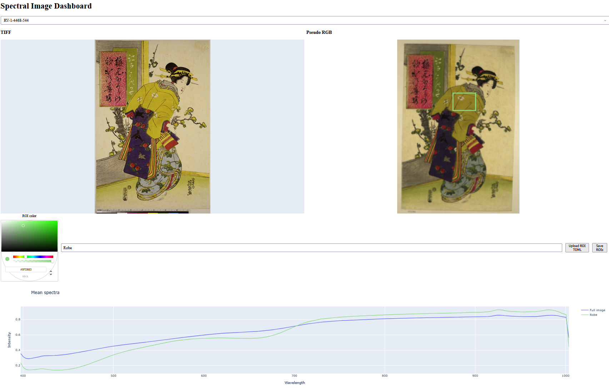

```{python}
#| eval: false

from fairdatanow import data_now
from hyperviz import make_dashboard

url = 'https://laboppad.nl/ukiyo-e-world' 

toml_txt = """
[data.npz]
RV-1-4468-544 = ".*RIS/interim/.*RV-1-4468-544.*[.]npz"
RV-1-4469-484 = ".*RIS/interim/.*RV-1-4469-484.*[.]npz"
RV-1-4469-58 = ".*RIS/interim/.*RV-1-4469-58.*[.]npz"
RV-1-4469-x6 = ".*RIS/interim/.*RV-1-4469-x6.*[.]npz"
RV-1-4469Q = ".*RIS/interim/.*RV-1-4469Q.*[.]npz"
RV-1-4470-12 = ".*RIS/interim/.*RV-1-4470-12.*[.]npz"
RV-1-4470-27 = ".*RIS/interim/.*RV-1-4470-27.*[.]npz"
RV-360-2345g = ".*RIS/interim/.*RV-360-2345g.*[.]npz"
RV-360-2359-2 = ".*RIS/interim/.*RV-360-2359-2.*[.]npz"
RV-360-6886 = ".*RIS/interim/.*RV-360-6886.*[.]npz"

[data.tif]
RV-1-4468-544 = ".*akama.*RV-1-4468-544[.]tif"
RV-1-4469-484 = ".*akama.*RV-1-4469-484[.]tif"
RV-1-4469-58 = ".*akama.*RV-1-4469-58[.]tif"
RV-1-4469-x6 = ".*akama.*RV-1-4469-x6[.]tif"
RV-1-4469Q = ".*akama.*RV-1-4469Q[.]tif"
RV-1-4470-12 = ".*akama.*RV-1-4470-12[.]tif"
RV-1-4470-27 = ".*akama.*1-4470-27[.]tif"
RV-360-2345g = ".*akama.*RV-360-2345-?g[.]tif"
RV-360-2359-2 = ".*akama.*RV-360-2359-2[.]tif"
RV-360-6886 = ".*akama.*RV-360-6886[.]tif"
"""

data = data_now(url, toml_txt)
make_dashboard(data, toml_txt)
```

```{python}
#| eval: false

from pathlib import Path

from hyperviz import make_dashboard

cache_root = Path.home() / ".cache" / "fairdatanow" / "ukiyo-e-world" / "data"
npz_root = cache_root / "RIS" / "interim"
tif_root = cache_root / "Photos-VIS" / "HR-Tif-longlist-WM-objecten_Fotografie_Prof-Ryo-Akama_Art-Research-Center-of-the-Ritsumeikan-University_Kyoto"

cached_files = {
    "RV-1-4468-544": ("2026-801_RIS.RV-1-4468-544.001_global_2026-04-13.npz", "ARC_RV-1-4468-544.tif"),
    "RV-1-4469-484": ("2026-801_RIS.RV-1-4469-484.001_global_2026-04-13.npz", "ARC_RV-1-4469-484.tif"),
    "RV-1-4469-58": ("2026-801_RIS.RV-1-4469-58.001_global_2026-04-21.npz", "ARC_RV-1-4469-58.tif"),
    "RV-1-4469-x6": ("2026-801_RIS.RV-1-4469-x6.001_global_2026-04-21.npz", "ARC_RV-1-4469-x6.tif"),
    "RV-1-4469Q": ("2026-801_RIS.RV-1-4469Q.001_global_2026-04-13.npz", "ARC_RV-1-4469q.tif"),
    "RV-1-4470-12": ("2026-801_RIS.RV-1-4470-12.001_global_2026-04-21.npz", "ARC_RV-1-4470-12.tif"),
    "RV-1-4470-27": ("2026-801_RIS.RV-1-4470-27.001_global_2026-04-21.npz", "ARC-1-4470-27.tif"),
    "RV-360-2345g": ("2026-801_RIS.RV-360-2345g.001_global_2026-04-21.npz", "ARC_RV-360-2345g.tif"),
    "RV-360-2359-2": ("2026-801_RIS.RV-360-2359-2.001_global_2026-04-21.npz", "ARC_RV-360-2359-2.tif"),
    "RV-360-6886": ("2026-801_RIS.RV-360-6886.001_global_2026-04-21.npz", "ARC_RV-360-6886.tif"),
}

data = {"npz": {}, "tif": {}}
for object_num, (npz_name, tif_name) in cached_files.items():
    data["npz"][object_num] = [npz_root / npz_name]
    data["tif"][object_num] = [tif_root / tif_name]

missing = [path for files in data.values() for paths in files.values() for path in paths if not path.exists()]
if missing:
    raise FileNotFoundError("Missing cached files:\n" + "\n".join(map(str, missing)))

make_dashboard(data, toml_text="")
```



## API

The following API reference is generated from the public functions and their
docstrings in `hyperviz.npz_dashboard`.

```{python}
#| echo: false
#| output: asis

import inspect
import hyperviz.npz_dashboard as module

for name, function in inspect.getmembers(module, inspect.isfunction):
    if function.__module__ == module.__name__ and not name.startswith("_"):
        signature = inspect.signature(function)
        docstring = inspect.getdoc(function) or "No documentation available."
        print(f"### `{name}{signature}`\n")
        print("```text")
        print(docstring)
        print("```\n")
```
